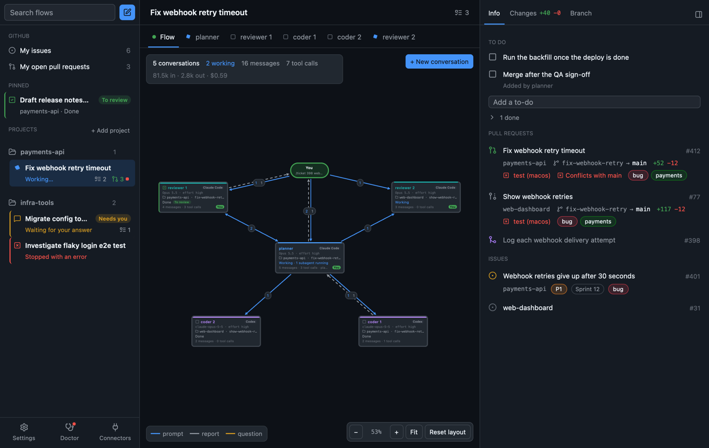

# Leon

One native window to run and follow many coding-agent conversations across
many repositories, on top of the coding CLIs you already use: Claude Code,
Codex and Copilot CLI.

Each flow's agents, and what they send each other:



One conversation per agent, as in its CLI:


## Why Leon

Coding agents now work in teams: a planner hands work to coders and
reviewers, often in several repositories at once. Leon gives each agent its
own conversation, through the official CLI and your own login, draws the
whole team as a live diagram, and shows what waits for you: answers to
review, questions, the to-dos left for you, each flow's changes and pull
requests. Native and fast
(Rust and GPUI); it never calls a model API itself and keeps everything on
your machine.

How it works, in plain language: [docs/how-leon-works.md](docs/how-leon-works.md).
What it does: [spec/features.md](spec/features.md).

**Status: v1, under review.** Claude Code and Codex are checked end to end;
Copilot CLI is wired up but not yet tested with the real CLI.

## Install

Leon needs macOS or Linux, [rustup](https://rustup.rs), and the CLIs you want
to use, installed and logged in (`claude`, `codex`, `copilot`), plus `gh` for
GitHub. The Doctor (bottom left in the app) checks all of this and says what
to fix.

## Build and run

The toolchain version is pinned in `rust-toolchain.toml` and installed on
first build.

As a Mac app (Leon.app with its icon, in /Applications):

```bash
cargo xtask bundle --install
```

Without `--install` it only builds `target/release/Leon.app`.

macOS asks Leon for access to folders such as Documents and Downloads. With
the default ad-hoc signature it asks again after every rebuild. To keep the
answer, sign with a certificate; the bundle step picks the first it finds in
your keychain:

1. **An Apple developer account** (preferred): Xcode → Settings → Accounts →
   your account → Manage Certificates… → + → *Developer ID Application* (or
   *Apple Development*).
2. **Without one**: Keychain Access → Keychain Access menu → Certificate
   Assistant → Create a Certificate…, name **Leon Local**, identity type
   *Self Signed Root*, certificate type *Code Signing*.

`LEON_SIGN_IDENTITY` names another one.

While working on Leon itself:

```bash
cargo run
```

Only one Leon runs at a time: quit the other one first.

Linux also needs the windowing and font libraries listed in
`.github/workflows/ci.yml`.

## Release

Pushing a version tag publishes a GitHub release
(`.github/workflows/release.yml`): a `.dmg` for macOS (Apple Silicon), signed
with a Developer ID and notarized by Apple, and the Linux binary.

```bash
git tag v0.1.0
```

```bash
git push origin v0.1.0
```

The workflow needs these repository secrets: `MACOS_CERTIFICATE_P12` (the
Developer ID certificate and key, exported as `.p12`, in base64),
`MACOS_CERTIFICATE_PASSWORD`, and an App Store Connect API key for
notarization: `NOTARY_KEY` (the `.p8` file's text), `NOTARY_KEY_ID`,
`NOTARY_ISSUER_ID`.

The same build on your Mac, with the key's path in `LEON_NOTARY_KEY` and
its ids in `LEON_NOTARY_KEY_ID` and `LEON_NOTARY_ISSUER`:

```bash
cargo xtask release
```

## Checks

```bash
cargo xtask ci
```

Runs formatting, clippy (warnings are errors), tests, the crate layer check and
`cargo-deny` (`cargo install --locked cargo-deny`).

## Where things live

| Path | What |
|---|---|
| `docs/how-leon-works.md` | How Leon works, in plain language, and the choices to review. |
| `docs/agent-files.md` | How Leon reads agent and skill files (`~/.agents/`) and hands them to each CLI. |
| `spec/` | Features, decisions, architecture. Read before changing anything. |
| `AGENTS.md` | Rules for anyone (human or AI) writing code here. |
| `crates/` | The app, split by layer (see `spec/architecture.md`). |
| `docs/ui-recipes.md` | GPUI patterns to copy. |
| `xtask/` | `cargo xtask ci` and the layer check. |

## Files Leon uses

- Settings: `~/.config/leon/config.toml` (or `$XDG_CONFIG_HOME/leon/`):

  ```toml
  version = 1

  [defaults]            # prefilled for a new flow
  backend = "claude"    # claude, codex, copilot
  permission = "auto"

  [diff]
  fold = ["glob:**/*.lock", "re:^generated/"]   # files folded in diffs

  [sources]
  folders = ["~/my-agent-kit"]   # agents/, skills/, commands/, .mcp.json
  ```

  Settings (bottom left in the app) edits this file for you and keeps your
  comments.

- Agents, skills and commands are also read from the usual folders:
  `~/.agents/`, `~/.claude/`, and the project's `.agents/`, `.claude/`,
  `.github/`.
- App data: `~/Library/Application Support/leon/` on macOS,
  `~/.local/share/leon/` on Linux: the flows (`state.db`) and the
  socket agents use to reach Leon's tools (`tools.sock`).

## Licence

[GNU AGPL-3.0](LICENSE): free to use, study, change and share. Anyone who
distributes a changed Leon, or offers it as an online service, must publish
their changes under the same licence.
